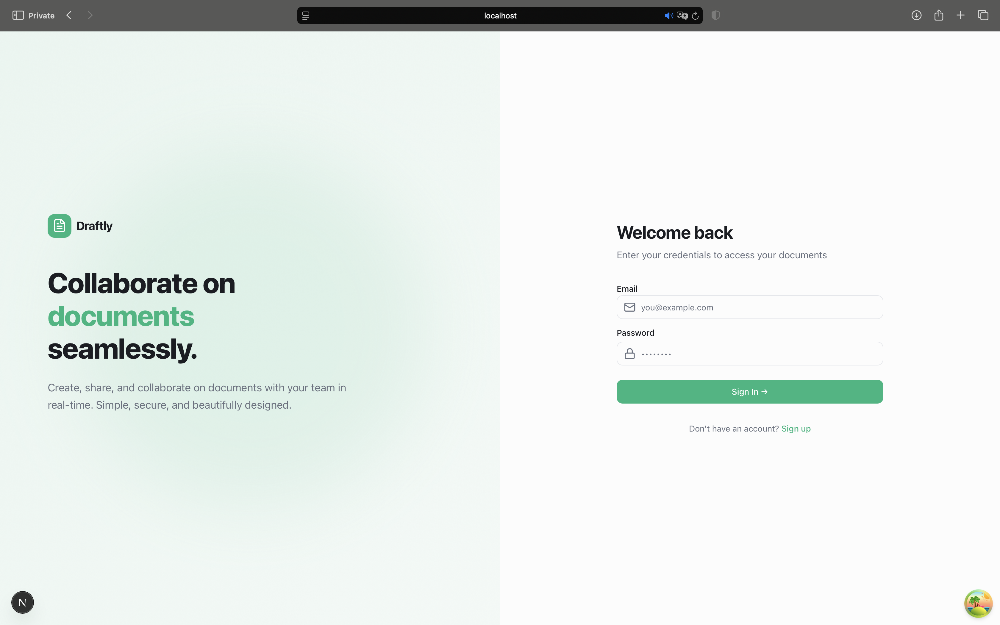
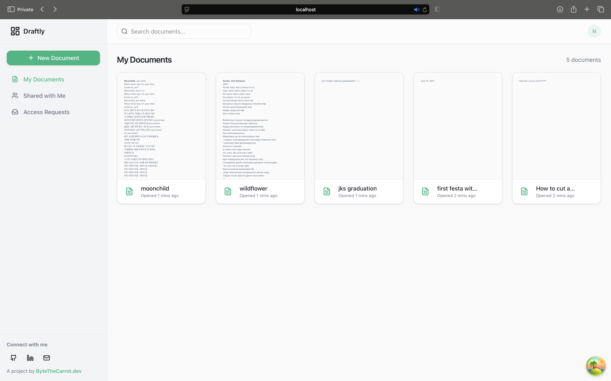
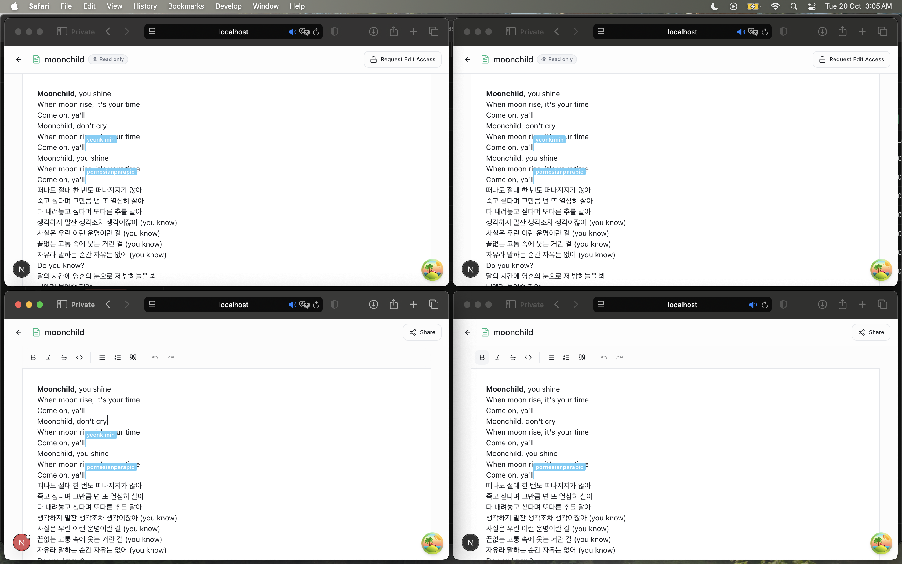
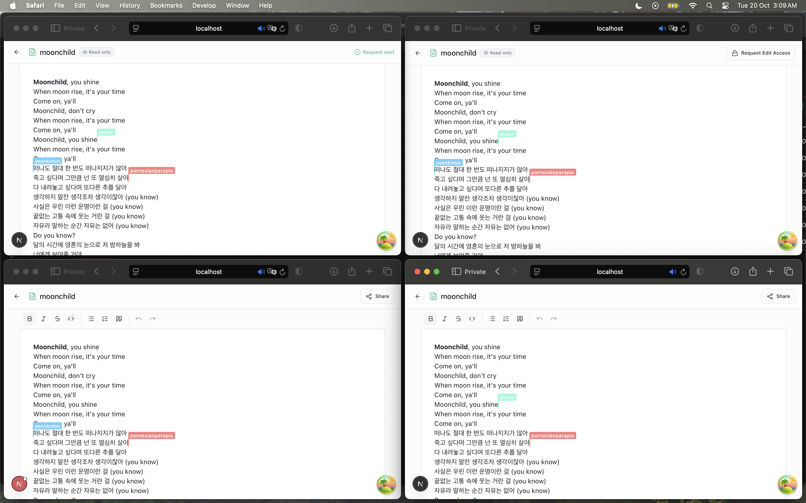
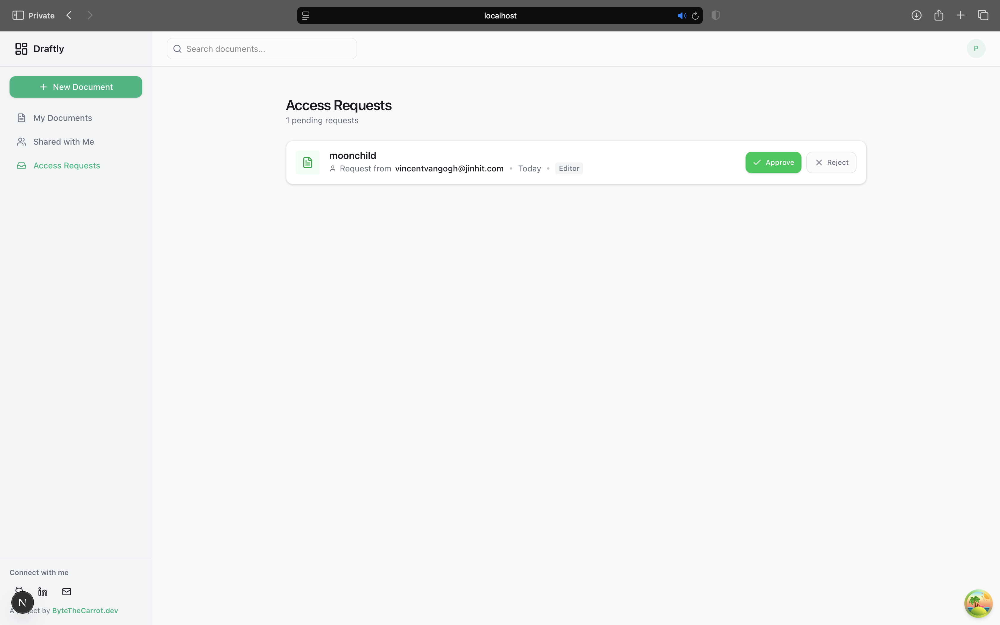
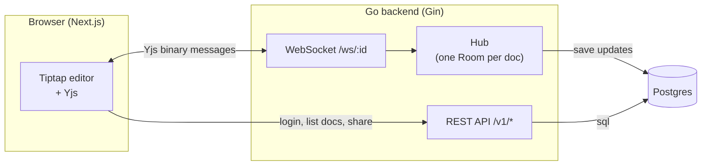
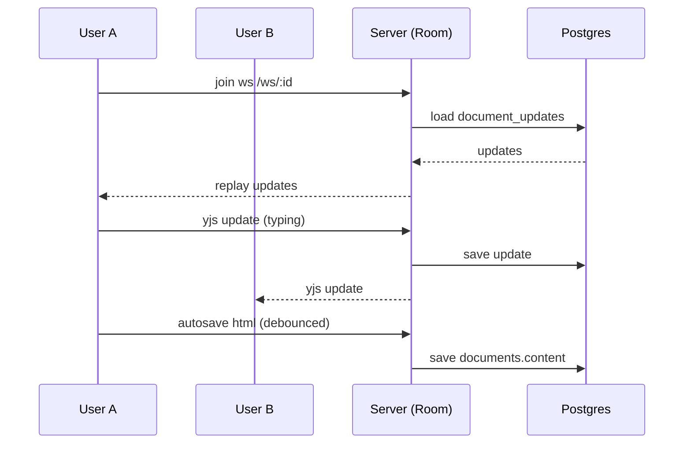

# Draftly Backend

This is the backend for Draftly, a small collaborative document editor.

It handles login, documents, sharing, and the live editing part.

## What it is

Draftly lets people write documents together in real time.

The main idea:

- People login/signup with just an email and a password.
- Each person can own up to 5 documents for now.
- You can invite other people to your document as an `editor` or a `viewer`.
- When two people open the same document, they see each other's typing live.
- There is no "save" button. The document is always saved.

The live editing is done with Yjs (a CRDT library) over WebSockets.

## Demo

<!-- > TODO: Live demo link -->

Here are the screenshots of the flow we care about.

**Login / signup**



**Sign up**


**Document list** ; your docs and the docs shared with you.



**Share dialog** ; inviting a user as editor or viewer.


**Live editing** ; two people typing in the same document.



**Live cursors** ; each person gets their own cursor color and name.



**Access requests** ; asking to see a doc you don't own.


**Access request is sent to author of doc** ; the author can either approve or reject a request



**No access** ; what you see when a doc link is opened without permission.


## Features

- Email + password login and signup in one endpoint. New users are created on the fly.
- JWT auth for all the document routes.
- Documents: create, read, rename, autosave, delete.
- Sharing: invite by email, list who has access, revoke access.
- Access requests: ask for access to a doc you don't own, owner approves or rejects.
- Share links via a token.
- Real time collaboration over websockets using Yjs.
- Roles: `owner`, `editor`, `viewer`.
- Limits: max 5 owned docs per user, max 3 signups per IP, size caps on title/content/token.
- HTML sanitizing before content is stored, so we don't save XSS junk.

## Architecture

The short version: REST is used for auth and metadata (who you are, what docs you have,
who can see them). The actual document text goes through websockets and Yjs.



### Who does what

- **REST for auth and metadata.** Login, documents list, sharing, permissions, access
  requests. These are normal request/response, easy to reason about, easy to test.
- **WebSocket rooms for content.** Every open document is a "room". Everyone in the room
  gets the Yjs messages of everyone else.
- **Yjs is the source of truth.** The real document is the Yjs CRDT. The `documents.content`
  column is just a plain HTML snapshot, good enough for thumbnails and non-live rendering.

### How persistence works

Every doc update that comes over the socket is a Yjs binary "update". We save those raw
blobs in the `document_updates` table, in order. When someone joins a room, we replay all
the saved updates to them, so they catch up.

On top of that:

- The client sends a debounced HTML snapshot to `PATCH /v1/documents/:id/autosave`.
- We store that cleaned HTML in `documents.content` for thumbnails.
- It's one-directional: Yjs -> snapshot. The editor never reads `documents.content` on load.



## Permissions

Roles are `owner`, `editor`, and `viewer`. Here is what each one can do:

| Action | Owner | Editor | Viewer |
| --- | :---: | :---: | :---: |
| Open the document | yes | yes | yes |
| See live edits | yes | yes | yes |
| Send live edits (typing) | yes | yes | no |
| Send cursor/presence | yes | yes | yes |
| Rename / edit content (REST) | yes | yes | no |
| Autosave snapshot | yes | yes | no |
| Delete document | yes | no | no |
| Invite people / manage access | yes | no | no |
| Revoke access | yes | no | no |
| Approve / reject access requests | yes | no | no |
| Request access | yes* | yes | yes |

\* an owner can't request access to their own doc (they already have full access).

A `viewer` can still open the socket and move their cursor, we only block the message type
that carries a real document change. So viewers stay live but never write.

## Setup

### Prerequisites

- Go 1.24 or newer
- A Postgres database (we use Supabase's pooler)
- Optional: a Supabase project if you want the extra keys

### Install

```bash
git clone https://github.com/carr-o-t/draftly-backend.git
cd backend
cp .env.example .env   # then fill in the values
go mod download
go run .
```

The server starts on port `8080` by default.

### Env vars

| Name | Required | Default | What it is |
| --- | :---: | --- | --- |
| `DATABASE_URL` | yes | none | Postgres connection string. Pooler URLs with `?pgbouncer=true` work. |
| `JWT_SECRET` | yes (prod) | `super-secret-key-change-me` | Secret used to sign login tokens. Change it in prod. |
| `PORT` | no | `8080` | Port the server listens on. |
| `SUPABASE_PROJECT_URL` | no | none | Supabase project url. Not really used yet. |
| `SUPABASE_API_KEY` | no | none | Supabase anon key. Not really used yet. |

### Useful commands

```bash
go test ./...                 # run all tests
go test ./... -cover          # run tests with coverage
go build ./...                # build everything
go vet ./...                  # basic static checks
go run . -reset               # drop and recreate all tables
go run ./cmd/reset_db         # same idea, older script
```

## Design decisions and tradeoffs

### Why Yjs instead of REST saves

We could have saved the whole document on every keystroke over REST. That breaks fast:

- Two people typing at once would overwrite each other.
- We'd hammer the database.
- Offline or flaky connections would lose edits.

Yjs is a CRDT. It merges edits from any number of people without conflicts, no matter the
order they arrive. Each edit is a tiny binary update we can save and replay. The client
does all the merging, the server just relays and stores.

The tradeoff: the server can't really "read" the content of a Yjs update. It's opaque. So
the plain HTML snapshot on the side is what we use for thumbnails and lists.

### Why per-room loops

Each document room runs its own goroutine with a single `for/select` loop over three
channels: `register`, `unregister`, and `broadcast`.

This keeps things simple and safe. Only one goroutine touches the room's client map, so we
don't need locks around it. A slow or dead client is dropped instead of blocking everyone.

The tradeoff: a room is tied to one server process. The `hub` lives in memory. So this only
works on a single instance for now. Scaling to many servers would need a shared pub/sub
(like Redis) so rooms can talk across instances. We're not there yet.

### The abuse limits

Small project, so a few simple guards:

- Max 5 owned documents per user.
- Max 3 signups per IP address.
- Caps on title (`255`), content (`1,000,000` chars), password (`72`, bcrypt's limit),
  email (`255`), and share tokens (`64`).
- HTML content is sanitized on write AND on read (so old rows get cleaned too).
- Socket frames capped at 5 MB.

These aren't perfect, but they stop the easy abuse and typos.

## Where we got stuck

### Yjs frames over websockets

Yjs messages are nested varints. The first number is the outer message type, the next is the
inner sync step. We only want to save the real document updates.

The bug: we first saved everything, including handshake and cursor messages, which made the
stored history grow and replay weird state.

The fix: we wrote a small parser (`realtime/protocol.go`). For each frame we peek the outer
type (must be `MsgSync`) and the step (must be `SyncUpdate`). Only those get saved. Cursor
and handshake messages are relayed but never stored.

### Only one message per websocket frame

After that, sync was still flaky. We were bundling several Yjs messages into one websocket
frame. The `y-websocket` client reads exactly one protocol message per frame. So it got
confused.

The fix: write each Yjs message as its own binary frame.

### The auth cookie vs the websocket

The auth cookie is HttpOnly, which is good for security, but the websocket client couldn't
read it to authenticate. So we added a second, non-HttpOnly `ws_token` cookie just for the
socket, sent as `?token=...` on the ws url. You need to log in again after this change so the
new cookie gets set.

### Viewers writing

Viewers could still send edits over the socket at first, because the write check was only on
the REST side. We moved the check into `readPump`: if the client is read-only and the frame
is a real sync update, we just skip it. Their cursor still works.

## Testing

We keep tests focused on the important stuff.

```bash
go test ./... -cover
```

What we cover:

- **services** (docs, auth, share): the real logic, using fake repos. No DB needed. ~90%.
- **middleware**: token checking. ~100%.
- **sanitize**: XSS stripping. ~100%.
- **utils**: JWT signing and validating. ~92%.
- **controllers**: real DB end to end flows (auth, documents, sharing). ~70-88%.
- **realtime**: the Yjs frame parser.

Some controller tests hit a real Postgres, so they need a working `DATABASE_URL`. If a test
fails because it can't reach the DB, that's usually why.

## Deployment notes

- Only needs `DATABASE_URL`, `JWT_SECRET`, and `PORT`.
- Migrations run on startup (GORM `AutoMigrate`). No separate migrate step.
- Ships as a single Go binary. `go build -o server .` then run `./server`.
- `CheckOrigin` on the websocket currently allows all origins. Need to tighten this before real
  production.
- The `hub` is in memory, so run a single instance for now.

## Known limitations

- Single instance only. No cross-server rooms yet.
- Share links are one per document and live for 10 years. No revoke or expire UI.
- The shared docs list shows role `viewer` for everyone, we didn't fetch the real role.
- No real-time presence list (who's online) shown to the user yet.
- No rate limiting on the REST API other than the IP signup cap.
- No CORS config yet.

## Roadmap

- Redis pub/sub so rooms work across multiple instances.
- Real role in the shared docs list.
- Proper share link management (expire, revoke).
- Per-document version history built from the saved Yjs updates.
- Real-time presence (who's viewing).
- Rate limiting and CORS for production.
